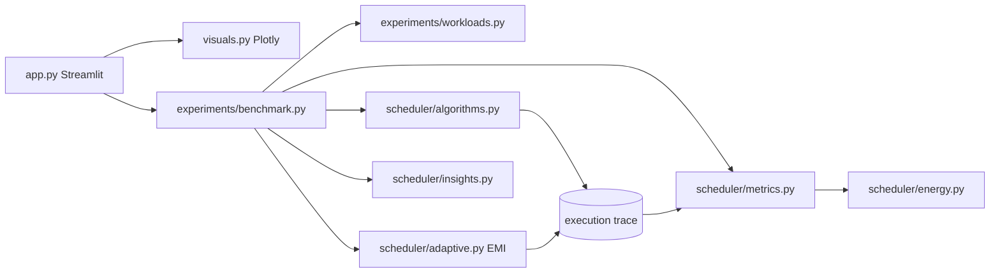

# EcoSched: An Adaptive, Energy-Aware CPU Scheduling Simulator with Workload Intelligence

## Abstract
EcoSched is an interactive simulator that runs five CPU scheduling policies (FCFS, SJF, Round Robin, preemptive Priority and
the adaptive **EcoMode Intelligence, EMI**) on identical workloads. Every metric (waiting, turnaround, response, utilization,
throughput, fairness, context switches and a *simulated* energy estimate) is computed from the recorded execution trace.
EMI is a transparent rule-based policy that chooses a Round Robin quantum from the workload. Its performance is judged
by the same measurements, repeated over many random seeds, including the cases where it loses.

## Problem statement
Scheduling algorithms optimise different goals and behave differently as workloads change. The project asks:
*under what workload conditions can an adaptive policy improve the balance between responsiveness, fairness, scheduling
overhead and estimated energy?* The simulator measures outcomes and does not assume the adaptive policy wins.

## Objectives
1. Implement five schedulers with a common, verifiable execution-trace format.
2. Compute all metrics from traces with one set of definitions.
3. Design an explainable adaptive policy and expose every threshold.
4. Evaluate on reproducible workloads, with Monte-Carlo robustness runs and sensitivity analysis.
5. Report wins and losses honestly, with auto-generated findings derived from the data.

## Unique contribution
| Feature | What it adds |
|---|---|
| EMI with evidence table | Six rules vote for latency / balanced / efficiency; the dashboard shows each rule, its inputs and the plain-English decision |
| Switch-cost-aware quantum | Quantum is never below `k x switch cost`, so the policy reacts to overhead |
| Completion grace + queue pressure | Run-time refinements: let nearly finished jobs finish; halve the quantum when many jobs wait |
| Trace verifier | Independent check of every trace (no overlap, no run before arrival, full burst executed once) |
| Quantum sweep | Shows where EMI's choice sits among *every* fixed Round Robin quantum |
| Monte-Carlo experiments | Win/loss rates over up to 100 seeds per profile, not a single cherry-picked run |
| Energy sensitivity | Energy-per-switch sweep and an overhead heat-map (EMI vs Round Robin) |
| Decision advisor | User-weighted relative score ("what matters most?") |
| SRTF reference (optional) | Classic waiting-time lower-bound baseline |

## Architecture


## Algorithms and conventions
* **FCFS**: non-preemptive, arrival order. **SJF**: non-preemptive, shortest burst among arrived jobs.
* **Round Robin**: fixed quantum; jobs arriving at the instant a slice ends join the queue *before* the preempted job.
* **Priority**: preemptive, *lower number = higher priority*. **SRTF** (reference): preemptive shortest remaining time.
* **Tie-breaks**: algorithm key, then arrival time, then process ID.
* **Clock** starts at the earliest arrival. **Context switch** = CPU moves directly from process A to a different process B with
  no idle gap; the first dispatch and a dispatch after idle are not switches. Each switch inserts `cs_cost` ticks of overhead.
* The dispatch decision is made before the overhead; arrivals during the overhead are considered at the next scheduling point.
* **EMI**: `quantum = clamp(ceil(factor[mode] x median burst), k x cs_cost, max)`; mode = highest rule points (ties -> balanced).

## Formulas
```
completion = end of last run segment        turnaround = completion - arrival
waiting    = turnaround - burst             response   = first start - arrival
utilization = run time / (trace end - trace start)        throughput = completed jobs / elapsed time
Jain J = (sum x)^2 / (n * sum x^2),  x_i = burst_i / (burst_i + waiting_i)    (1 = equal, 1/n = one hog)
energy = P_active*t_run*u + P_idle*t_idle*u + E_switch*n_switches            (u = seconds per tick)
```
**SIMULATED ENERGY ESTIMATE — NOT MEASURED HARDWARE POWER.** Jain's index treats equal slowdown as fair and ignores priorities.

## Installation and running
```bash
python -m venv .venv && source .venv/bin/activate      # Windows: .venv\Scripts\activate
pip install -r requirements.txt
python -m streamlit run app.py
```
Runs fully offline; no database, API key or internet needed at runtime.

## Tests
```bash
python -m pytest -q
```
29 tests: hand-calculated schedules for every algorithm, simultaneous arrivals, idle gaps, single process, switch counting and
overhead, formulas, invalid input, zero denominators, EMI rules, energy arithmetic, plus invariants (no run before arrival,
no overlaps, exact burst executed, single completion, non-negative waiting) for every scheduler on many workloads.

## Example workload (Classic demo)
| PID | Arrival | Burst | Priority | Category |
|---|---|---|---|---|
| 1 | 0 | 8 | 4 | batch |
| 2 | 1 | 2 | 1 | interactive |
| 3 | 2 | 14 | 6 | cpu-intensive |
| 4 | 3 | 3 | 2 | interactive |
| 5 | 6 | 5 | 3 | batch |
| 6 | 8 | 2 | 1 | interactive |

## Experimental methodology
Four profiles (Interactive, Batch, Mixed, High load) with fixed seeds 11/22/33/44. For robustness, each profile is regenerated with
seeds 1000-1029 (30 workloads). Settings: Round Robin quantum 4, switch overhead 1 tick, energy 10 W active / 2 W idle /
0.05 J per switch / 10 ms per tick, default EMI rules. Reproduce in **Experiment Lab -> Monte-Carlo**.

## Results (actually executed: 30 seeds per profile, default settings)
"EMI beats / loses to RR" compares EMI with fixed Round Robin (q = 4) per seed; lower is better for every metric listed except fairness.

| Profile | Metric | EMI mean | RR (q=4) mean | EMI beats RR % | EMI loses to RR % |
|---|---|---:|---:|---:|---:|
| Interactive | Avg response | 9.06 | 9.06 | 0 | 0 |
| Interactive | Context switches | 10.27 | 10.27 | 0 | 0 |
| Batch | Avg response | 55.42 | 10.73 | 0 | 100 |
| Batch | Avg waiting | 55.42 | 122.92 | 100 | 0 |
| Batch | Context switches | 5.00 | 34.87 | 100 | 0 |
| Batch | Energy (J, simulated) | 13.87 | 15.36 | 100 | 0 |
| Batch | Jain fairness (higher better) | 0.68 | 0.99 | 0 | 100 |
| Mixed | Avg response | 19.62 | 15.34 | 7 | 67 |
| Mixed | Avg waiting | 41.86 | 49.05 | 97 | 0 |
| Mixed | Context switches | 20.20 | 26.53 | 97 | 0 |
| Mixed | Energy (J, simulated) | 10.75 | 11.07 | 97 | 0 |
| High load | Avg response | 70.88 | 43.71 | 0 | 100 |
| High load | Avg waiting | 101.39 | 148.64 | 100 | 0 |
| High load | Context switches | 24.87 | 51.60 | 100 | 0 |
| High load | Energy (J, simulated) | 19.39 | 20.73 | 100 | 0 |
| High load | Jain fairness (higher better) | 0.34 | 0.63 | 30 | 70 |

**Reading these numbers (measured outcomes only):** under these settings EMI used fewer context switches, lower average waiting
time and lower simulated energy than fixed q=4 Round Robin on the Batch, Mixed and High-load profiles, but had worse average response
time on those same profiles (and lower fairness on Batch and High load). On the Interactive profile EMI selected the same quantum as
Round Robin (the switch-cost floor of 4 x 1 = 4), so the two were identical. Results depend on the parameters and will change with
other settings; see the sensitivity tools. The full table, including all five schedulers, is in the Experiment Lab.

## Screenshots
_Add screenshots here after running the app: Overview, Scheduler Arena, EcoMode Intelligence, Performance Observatory._

## Limitations and future work
Single core; no I/O, memory, cache or multi-core effects; integer ticks; synthetic workloads; energy values are assumptions.
Future work: multi-level feedback queue, I/O bursts, multi-core scheduling, calibrating the energy model with real power
measurements (e.g. RAPL on Linux), and learning the EMI thresholds from data (kept rule-based here for explainability).
